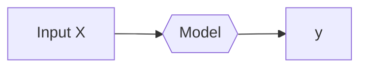
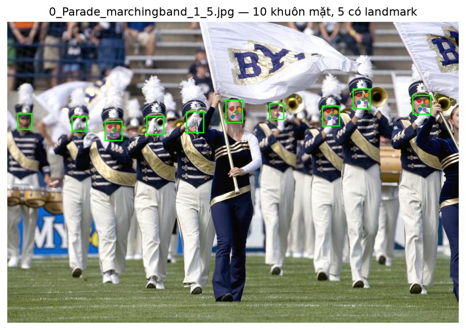
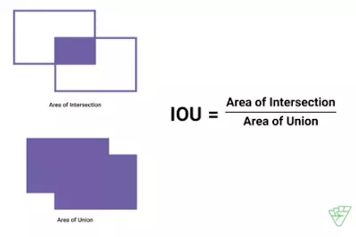
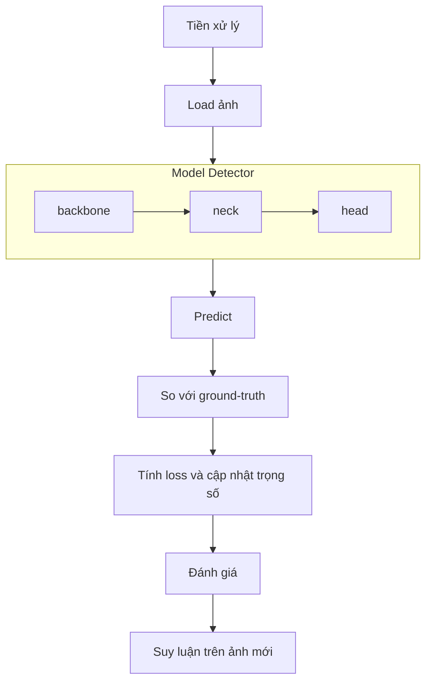

## A2.1. Chủ đề + paper + dữ liệu

### Chủ đề

Ở assignment A2 này, chủ đề được lựa chọn để thực hiện thuộc nhóm **"Phát hiện đối tượng"**, cụ thể là **"Phát hiện khuôn mặt"** với đầu vào là một ảnh bất kì.



Trong đó:

- **X:** là một ảnh đầu vào, có dạng [C, H, W]
- **Model:** là phần được thực hiện ở phần này.
- **y:** là output dùng để xác định khuôn mặt có trong ảnh, với dạng là array của [l, cx, cy, w, h, x1, y1, x2, y2, x3, y3, x4, y4, x5, y5]
  - l: label với 0 là face
  - cx, cy: tâm (center) của boundary box
  - w, h: là kích thước của bbox
  - x_n, y_n: lần lượt là vị trí của các landmarks

### Citation paper

- Paper: **YOLO5Face: Why Reinventing a Face Detector**
- Authors: **Delong Qi, Weijun Tan, Qi Yao, Jingfeng Liu**
- Year: **2021**
- Venue: **Published in Computer Vision – ECCV 2022 Workshops (Springer, pages 228–244)**
- Affiliations: **Shenzhen Deepcam Information Technologies (China) and LinkSprite Technologies (USA)**
- Cite as: **[arXiv:2105.12931 [cs.CV]](https://arxiv.org/abs/2105.12931)**
- DOI: **10.48550/arXiv.2105.12931**
- Source Code / Repository: **Available on [GitHub - deepcam-cn/yolov5-face](https://github.com/deepcam-cn/yolov5-face)**

### Dataset

- Tập dữ liệu được sử dụng cho A2 này là **WIDERFace**: Một bộ dữ liệu chuẩn về khả năng nhận diện khuôn mặt quy mô lớn được tạo ra bởi Phòng thí nghiệm Đa phương tiện thuộc Đại học Trung văn Hồng Kông (CUHK).
- Tổng cộng có: **32,203 ảnh**.
- Số khuôn mặt được đánh nhãn có boundary box: **393,703**
- Được tổ chức thành **61 danh mục sự kiện** khác nhau (như thể thao, giao thông, hội họp và biểu tình) với sự đa dạng cao về quy mô, tư thế, biểu cảm, ánh sáng và sự che khuất.
- Data Splits:

| Tập      | Số ảnh | Tỷ lệ |
| -------- | ------ | ----- |
| Training | 12,880 | 40%   |
| Val      | 3,226  | 10%   |
| Test     | 16,097 | 50%   |

Sau khi chạy `train2yolo` và `val2yolo` để chuyển định dạng thành YOLO cho quá trình training model với label annotation, mỗi ảnh train và val sẽ có một file `*.txt` riêng cùng tên với ảnh. Mỗi khuôn mặt được đánh nhãn là một dòng với nội dung như sau:

```
0  cx cy w h  x1 y1 x2 y2 x3 y3 x4 y4 x5 y5
```

Tương tự với cách chú giải ở trên:

- 0: là class face
- cx cy w h: là boundary box, chuẩn hóa về 0-1 theo kích thước ảnh.
- các x_n, y_n là vị trí các landmark, cũng được chuẩn hóa 0-1. Điểm nào không có nhãn thì được ghi `-1`.

_Việc chuẩn hóa về 0-1 giúp ích cho việc không cần phải tính lại vị trí của các điểm trên khi thay đổi kích thước ảnh_.

Ví dụ:

Ảnh có tên `0_Parade_marchingband_1_5.jpg` là:


Với annotation tương ứng có tên `0_Parade_marchingband_1_5.txt` là:

```txt
0  0.50146484375 0.2964860907759883 0.0361328125 0.0746705710102489 0.4964423828125 0.2896354319180088 0.51370703125 0.2896354319180088 0.50680078125 0.2981068814055637 0.4986396484375 0.31363689604685213 0.51370703125 0.31269546120058567
0  0.4150390625 0.3323572474377745 0.037109375 0.07027818448023426 -0.0009765625 -0.0014641288433382138 -0.0009765625 -0.0014641288433382138 -0.0009765625 -0.0014641288433382138 -0.0009765625 -0.0014641288433382138 -0.0009765625 -0.0014641288433382138
0  0.3271484375 0.34260614934114203 0.037109375 0.06149341142020498 -0.0009765625 -0.0014641288433382138 -0.0009765625 -0.0014641288433382138 -0.0009765625 -0.0014641288433382138 -0.0009765625 -0.0014641288433382138 -0.0009765625 -0.0014641288433382138
0  0.234375 0.3616398243045388 0.037109375 0.06149341142020498 0.22659765625 0.3484099560761347 0.244384765625 0.3484099560761347 0.236275390625 0.35899853587115665 0.229212890625 0.3735095168374817 0.2425537109375 0.37390190336749635
0  0.0380859375 0.3301610541727672 0.03125 0.05124450951683748 -0.0009765625 -0.0014641288433382138 -0.0009765625 -0.0014641288433382138 -0.0009765625 -0.0014641288433382138 -0.0009765625 -0.0014641288433382138 -0.0009765625 -0.0014641288433382138
0  0.91748046875 0.2745241581259151 0.0400390625 0.0629575402635432 0.91109765625 0.2620395314787701 0.9289375 0.26244509516837483 0.920017578125 0.27662957540263544 0.912990234375 0.28878623718887264 0.92353125 0.2891918008784773
0  0.7841796875 0.2554904831625183 0.037109375 0.06588579795021962 0.7782509765625 0.2438814055636896 0.7955498046875 0.24220937042459736 0.7877373046875 0.2564319180087848 0.7782509765625 0.2681449487554905 0.7935966796875 0.267307467057101
0  0.71630859375 0.31112737920937045 0.0380859375 0.06588579795021962 0.71044921875 0.29617276720351393 0.726353515625 0.2974275256222548 0.7190986328125 0.308303074670571 0.712681640625 0.31876134699853587 0.72412109375 0.3191800878477306
0  0.595703125 0.2972181551976574 0.03125 0.0527086383601757 -0.0009765625 -0.0014641288433382138 -0.0009765625 -0.0014641288433382138 -0.0009765625 -0.0014641288433382138 -0.0009765625 -0.0014641288433382138 -0.0009765625 -0.0014641288433382138
0  0.15869140625 0.3389458272327965 0.0322265625 0.048316251830161056 -0.0009765625 -0.0014641288433382138 -0.0009765625 -0.0014641288433382138 -0.0009765625 -0.0014641288433382138 -0.0009765625 -0.0014641288433382138 -0.0009765625 -0.0014641288433382138
```

Thì khi mask boundary box lên ảnh ta được:



### Metric

#### IoU

Một boundary box (bbox) dự đoán cần được ghép với bbox của ground-truth, tức là so với các annotation, bằng **Intersection over Union (IoU)**:

$$\text{IoU} = \frac{\text{diện tích giao nhau}}{\text{diện tích hợp}}$$


_Fig.1. Minh họa cách tính IoU_

Giá trị IoU càng cao tức là hai box càng khớp nhau. Với dataset WIDERFace, ngưỡng đánh giá là **0.5** (theo protocol PASCAL VOC).

Sau khi ghép dự đoán với ground truth, ta có:

- TP: phát hiện đúng một khuôn mặt.
- FP: dự đoán không khớp mặt hợp lệ, hoặc phát hiện trùng một mặt đã được ghép.
- FN: mặt hợp lệ bị bỏ sót.

#### Precision và Recall

$$
\begin{aligned}
\text{precision} &= \frac{TP}{TP + FP} = \frac{TP}{\text{Tổng số dự đoán}} \\
\text{recall} &= \frac{TP}{TP + FN} = \frac{TP}{\text{Tổng số gt-box}}
\end{aligned}
$$

- Precision: có thể suy luận ra độ chính xác của model khi dự đoán đúng trong các mặt được model tìm thấy. Dùng để kiểm tra phát hiện nhầm.
- Recall: trả lời cho câu hỏi "trong các mặt thực sự có, model tìm được bao nhiêu?". Dùng để kiểm tra bỏ sót.

#### Average Precision (AP)

Từ precision và recall đã tìm được ở phía trên ta có thể vẽ được đường cong precsion theo recall (PR curve) cho mỗi class riêng biệt. Nó chỉ ra sự đánh đổi giữa precision và recall đối với nhiều giá trị confidence score khác nhau. AP chính là phần diện tích phía dưới đường cong PR curve đã nói bên trên. Nếu phần diện tích này lớn đồng nghĩa với việc precision và recall sẽ cao đồng nghĩa model có chất lượng tốt.

Cho biết khả năng phát hiện trên từng mức khó, xét nhiều confidence threshold, được xem là metric chính.

AP trên ba mức **Easy / Medium / Hard**.

### Kế hoạch pipeline



#### Tiền xử lý

- Các ảnh có kích thước khác nhau cần được đưa về khích thước đầu vào phù hợp.
- Có thể thêm các augmentation phù hợp như lật ngang, thay đổi màu hoặc crop, cần áp dụng tương ứng lên annotation khi có biến đổi hình học.

#### Load ảnh

- Với các ảnh sau khi được xử lý, dùng **DataLoader** để gom nhiều mẫu thành một batch.

#### Model detector

Bao gồm 3 phần chính:

- **Backbone**: trích xuất đặc trưng từ ảnh.
- **Neck**: kết hợp đặc trưng ở nhiều độ phân giải.
- **Head**: dự đoán vị trí mặt, confidence và landmarks.

Model được khởi tạo ngẫu nhiên.

#### Ghép dự đoán với ground-truth và tính loss

Trong quá trình dự đoán, model sẽ tạo ra nhiều ứng viên. Lúc này cần xác định dự đoán nào chịu trách nhiệm học mỗi khuôn mặt.

Loss của YOLO5Face bao gồm các thành phần:

- **Bounding box**: vị trí và kích thước khuôn mặt.
- **Objectness**: dự đoán có đối tượng hay không.
- **Classification**: lớp đối tượng.
- **Landmarks**: sai lệch vị trí các điểm hợp lệ.

#### Đánh giá

Sau mỗi epoch:

- Chuyển model qua chế độ evaluation.
- Chạy dự đoán trên validation.
- Lọc dự đoán trùng, so với ground-truth.
- Tính metric, ghi log, lưu checkpoint.
